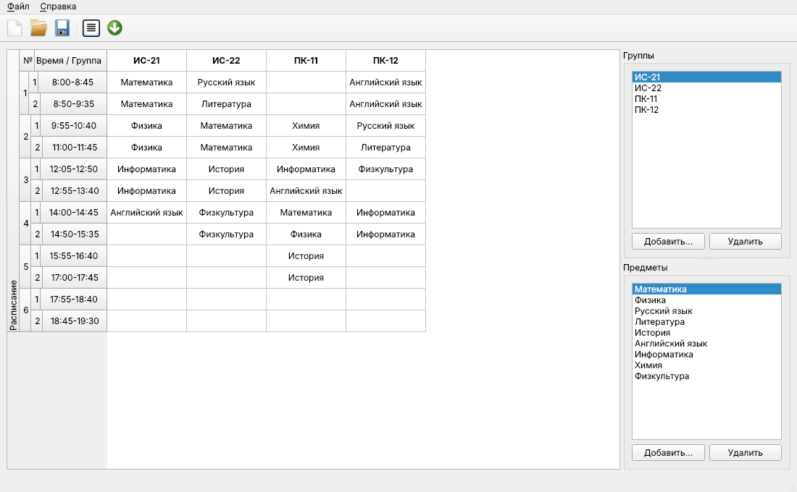

# Schedule

[](../../actions/workflows/build.yml)


Desktop editor for a school / college class timetable written in C++ and Qt Widgets.
Groups are columns, lessons are rows, the bell schedule is shown in a multi-level header.
The timetable can be saved as JSON, printed or exported to PDF.

*Настольный редактор расписания занятий учебного заведения (C++ / Qt). Описание на русском — [ниже](#по-русски).*



## Features

- Editable timetable: 6 pairs × 2 lessons for any number of groups.
- Subjects are picked from a combo box, so a cell can never contain a typo or an unknown subject;
  removing a subject clears all lessons that used it (after confirmation).
- Multi-level vertical header (pair → lesson → time) built on a custom `QHeaderView`.
- JSON file format with versioning, validation and a reader for files from version 1.0.
- Atomic saving via `QSaveFile` — a crash or a full disk never leaves a half-written file.
- Unsaved-changes tracking (`[*]` in the title, prompt on close / open / new).
- Printing and PDF export (A4 landscape) from the same HTML renderer.
- English UI with a complete Russian translation, chosen from the system locale.
- Window layout and the last opened file are restored on start; a file can be passed on the command line.

## Building

Requirements: CMake ≥ 3.16, a C++17 compiler, Qt 6 (preferred) or Qt 5.15 with the
Widgets, PrintSupport and LinguistTools modules.

```bash
cmake -S . -B build -DCMAKE_BUILD_TYPE=Release
cmake --build build
ctest --test-dir build --output-on-failure
./build/schedule examples/sample.json
```

<details>
<summary>Installing Qt</summary>

- **Ubuntu / Debian:** `sudo apt install qt6-base-dev qt6-tools-dev qt6-l10n-tools libgl-dev`
- **macOS (Homebrew):** `brew install qt`, then pass `-DCMAKE_PREFIX_PATH=$(brew --prefix qt)`
- **Windows:** install Qt via the [online installer](https://www.qt.io/download-qt-installer)
  and pass `-DCMAKE_PREFIX_PATH=C:/Qt/6.x.x/msvc2022_64`
</details>

CMake options:

| Option | Default | Description |
|---|---|---|
| `SCHEDULE_BUILD_TESTS` | `ON` | Build unit tests |
| `SCHEDULE_WARNINGS_AS_ERRORS` | `OFF` | `-Werror` / `/WX` (enabled in CI on Linux) |

## Project structure

```
src/
  schedulemodel.*      QAbstractTableModel: data, validation, JSON (de)serialization
  timetable.h          bell schedule — single source of truth for the header and the export
  htmlexport.*         HTML rendering used for printing and PDF
  comboboxdelegate.*   cell editor, takes the list of choices from the model
  mainwindow.*         UI, file handling, printing
  main.cpp             application setup, translations, command line
tests/                 Qt Test unit tests (+ QAbstractItemModelTester)
third_party/           HierarchicalHeaderView (BSD), ported to Qt 6
translations/          Russian translation (.ts, compiled at build time)
examples/sample.json   example timetable
```

The model and the exporter are built as a separate static library (`schedule_core`) without
the main window, so they are covered by unit tests that run headless in CI.

## File format

```json
{
    "version": 2,
    "subjects": ["Math", "Physics"],
    "groups": [
        { "name": "10A", "lessons": ["Math", "", "Physics", "", "", "", "", "", "", "", "", ""] }
    ]
}
```

`lessons` always has one entry per lesson slot (empty string — no lesson), so data positions are
explicit. Unknown subjects and duplicate groups are rejected on load; a file from a newer
format version is refused instead of being silently misread.

## Updating translations

```bash
cmake --build build --target update_translations   # Qt 6: refresh .ts from sources
```

Then edit `translations/schedule_ru.ts` in Qt Linguist; `.qm` files are generated during the build.

## По-русски

**Schedule** — редактор расписания занятий: группы — столбцы, уроки — строки, звонки
показаны в многоуровневом заголовке (пара → урок → время). Расписание сохраняется в JSON,
печатается и экспортируется в PDF. Интерфейс на английском и русском (выбирается по языку системы).

Сборка: `cmake -S . -B build && cmake --build build`, тесты: `ctest --test-dir build`.
Нужны CMake ≥ 3.16, компилятор C++17 и Qt 6 или Qt 5.15.

## License

[MIT](LICENSE). `third_party/hierarchicalheaderview` — BSD license, © 2009 Krasnoshchekov Petr.
